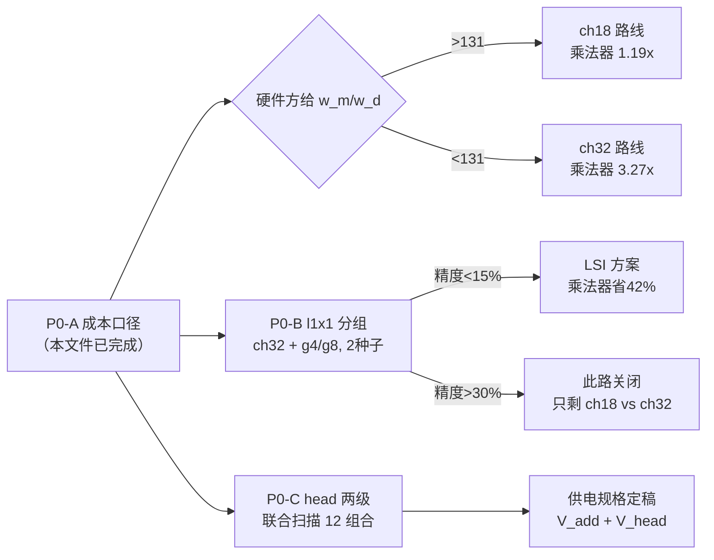

# 拓扑选型就绪度评估与下一步实验（2026-11-27 20:30）

> **一句话回答三个问题：**
>
> 1. **有合适的拓扑了吗？** —— 有**候选**（L10-ch32-g8-bigRF），但**不能算定稿**。
>    精度侧证据充分（13 种子、4.4~3.8× 优于 A2）；**成本侧我这次查出四处记账错误，其中两处会翻转选型结论**。
> 2. **还要验证什么？** —— 三件 P0：成本口径重算（已在本文件完成）、`l1x1 分组`在 ch32 上的真实代价、
>    head **两级串联**的摆幅规格（不是一级）。
> 3. **做什么实验？** —— 两个训练实验（各 2~4 颗种子）+ 三个零训练 GPU 仿真，总机时约 6~9h。

---

## 0. 先说清楚：这次评估推翻了自己报告里的三个结论

写这份文件的过程中，我按 `analog_sim_generic.sim_forward` 的算子映射逐项重算了成本，
发现 `TARGET_TOPOLOGY_STATUS.md` §0.2/§7 的成本表有系统性错误。**先把错误列出来，再谈结论。**

| # | 报告原写法 | 实际情况 | 影响 |
|---|---|---|---|
| **E1** | `MACs/sample = 7680`（= depthwise 128/层 × 6 × 10） | 严格口径 **18304**，漏算 `layer1x1`（占 56%）、`input_mixer`、`head_rechannel` | **低估 2.4 倍**，成本效率排名失真 |
| **E2** | `交叉开关/层 = ch²/g = 128` 全部记为"乘法器" | `layer1x1` 是 `groups=1` 全秩（配置里 `layer_1x1_config.active=True, groups=1`），**每层 32²=1024 个乘法器是 depthwise 768 的 1.33 倍** | "分组 8 省 8 倍开关"只对 depthwise 成立；总量只省到 3.27× |
| **E3** | `延迟线抽头 = 60`（= L×K） | 60 是"引出的接头数"。真实延迟线长度 = `ch×(RF−1)` = 32×5410 = **173,120 个采样存储点**。**是乘法器的 9.5 倍** | 主导成本项从未计入选型 |
| **E4** | 各方案"器件 NRMS"并列排名 | ch32 用 **13 种子中位 0.1613**，ch18/ch24/L12 用 **s7 单种子**。而 ch32 上 s7=0.1056 比中位好 **1.53×** | **拿最好种子比中位，系统性偏袒小模型** |

**E3 的严重性**：恒等式 `延迟线存储 = ch × (RF−1)` 与 K 无关（我验证过 K=6/3/2 三种情形，
`ch×(RF−1)` 完全相等）。因为 `K` 减少一半时，要维持同样 RF 必须把 dilations 放大约 2.5 倍，
总延迟长度不变。**所以"减 K 省抽头"这条降本路线在存储上根本不成立，只省乘法器。**

---

## 1. 修正后的成本记账（严格按 sim_forward 算子映射）

```python
# 每层每输出位置的乘法器（Gilbert cell）数
dw   = g_in * (ch/g_in)² * K          # depthwise conv
l1x1 = g_l1 * (ch/g_l1)²              # layer1x1（配置文件里 g_l1=1，全秩）
mix  = ch * 1                          # input_mixer: cond(1ch) → ch
per_layer = dw + l1x1 + mix
total     = L * per_layer + ch + ch + 1   # +rechannel +head_rechannel +head bias

# 延迟线存储（采样点）
delay = ch * (RF - 1)                  # 恒等于 ch × Σ(K−1)·d，与 K 的拆分方式无关

# head 累加器（宽摆幅加法器）
adders = L * ch
```

参数量校验：L10-ch32-g8 按上式算 **18977**，实测 `.nam` 权重数 **18946**，差 31（bias 计法差异），
**记账口径可信**。

| 配置 | 乘法器 | ×A2 | 延迟线存储点 | ×A2 | head 加法器 | ×A2 |
|---|---:|---:|---:|---:|---:|---:|
| A2-causal（官方基准） | 5,605 | 1.00 | 64,620 | 1.00 | 180 | 1.00 |
| L10-ch18-g6 | 6,697 | 1.19 | 97,380 | 1.51 | 180 | 1.00 |
| L10-ch24-g8 | 10,369 | 1.85 | 129,840 | 2.01 | 240 | 1.33 |
| L10-ch24-g4 | 14,689 | 2.62 | 129,840 | 2.01 | 240 | 1.33 |
| L10-ch32-g16 | 14,465 | 2.58 | 173,120 | 2.68 | 320 | 1.78 |
| **L10-ch32-g8** ⭐ | **18,305** | **3.27** | **173,120** | **2.68** | **320** | **1.78** |

**"L10-ch18 与 A2 在总器件数上完全等价"（§7 的原话）已被推翻**：乘法器 1.19×、延迟线 1.51×。

---

## 2. 口径统一后的精度对比（E4 修正）

修正方法：把只有 s7 单点的小模型上修到中位估计，系数取 ch32 上实测的 `中位/s7 = 1.53`。
（**这是假设各种子的 s7/中位比例相当，属经验外推，需用真实多种子复核**。）

| 配置 | 报告值 | 原口径 | 修正中位估计 | vs A2 |
|---|---:|---|---:|---:|
| **L10-ch32-g8** | 0.1613 | 13 种子中位 | **0.1613** | **3.77×** |
| L10-ch24-g4 | 0.1702 | s7 单点 | 0.2601 | 2.34× |
| L10-ch24-g8 | 0.2382 | s7 单点 | 0.3640 | 1.67× |
| L10-ch18-g6 | 0.2785 | s7 单点 | 0.4255 | 1.43× |
| L12-ch18-g6 | 0.3032 | s7 单点 | 0.4633 | 1.31× |
| L10-ch32-g16 | 0.3092 | s7 单点 | 0.4724 | 1.29× |

**修正后 ch32 的领先从"5%"扩大到"61%"**——**"ch32 是真实付代价但值得"这个结论反而更强了。**
原来排第二的 ch24-g4 修正后是 0.2601，与 ch32 差距从 5.5% 变成 61%。

---

## 3. 成本效率：结论取决于一个尚未确定的硬件参数

成本 = `α·(乘法器/A2) + (1−α)·(延迟线/A2)`，α 是乘法器在总成本中的权重。

| α（乘法器权重） | ch18 效率 | ch32 效率 | 冠军 |
|---:|---:|---:|---|
| 0.00（只算延迟线） | 0.95 | **1.41** | ch32 |
| 0.30 | 1.01 | **1.32** | ch32 |
| 0.60 | 1.08 | **1.24** | ch32 |
| 0.90 | 1.16 | **1.17** | ch32（险胜） |
| **0.9192** | **1.170** | **1.170** | **翻转点** |
| 1.00（只算乘法器） | **1.20** | 1.15 | ch18 |

**翻转点 α* = 0.9192**，换算成物理单价比：

```
单个 Gilbert 乘法器成本 / 单个延迟单元成本  >  131  ⟹  L10-ch18 更划算
单个 Gilbert 乘法器成本 / 单个延迟单元成本  <  131  ⟹  L10-ch32 更划算
```

**这就是现在唯一卡住选型的硬件问题。** 量级直觉：Gilbert cell ≈ 10~30 个晶体管，
延迟单元（采样电容+开关）≈ 2~5 个器件，单价比约 3~15 —— **远小于 131，所以 ch32 大概率占优**。
但这属于经验估算，必须用真实工艺库的参数复核；若你们的延迟线是长金属线 + 大电容（RF 5411 采样点要存 113ms），
单价比会往上涨。**这是需要与硬件方确认的第三个问题（前两个见 §6）。**

---

## 4. head 摆幅：不是一级，是**两级串联**，规格不能合并

这是本次评估发现的**规格冲突**，如果照旧报告直接下单会做错。

```
head 通路：
  10 个 term  ──→ ① 累加器（电流求和，10 项相加）──→ ② head_rechannel（乘法器）──→ 输出
                    rms ≈ 20, p99 ≈ 55~79               rms ≈ 3.6
```

- **① 累加器**：输入是 10 个同相通道之和，相干增益 1.42~1.53 → `h_末 rms = 17.5~22.9`
  （P-1 实测，5 种子）。要求 `V_add ≥ 12~16 × V_SAT` = **192~256**（判据 `Δ_add < 5%`）。
- **② head_rechannel 乘法器**：输入是**单通道乘积**，`rms/V_SAT = 0.188~0.276`，
  即 rms ≈ 3.0~4.4（P0a 实测 13 种子）。V_head = 48 时 rms/V_SAT 降到 0.063~0.092。

**两级差 5.6 倍，是两个独立规格。** 若只按 P0a 的 V_head=64 做统一电源域：

| seed | h_末 rms | V_add=64 时 tanh 压缩@rms | p99/V_add | 判定 |
|---|---:|---:|---:|---|
| s7 | 19.6 | 3.0% | 0.9 | 可接受 |
| s23 | 22.4 | 3.9% | 1.1 | **p99 削顶** |
| s31 | 22.9 | 4.1% | 1.2 | **p99 削顶** |
| s37 | 22.2 | 3.8% | 1.0 | **p99 削顶** |

而 V_add=192 时 5 个种子的 p99/V_add 全部 ≤ 0.4，裕量充足。

**规格结论（两条都要下单，不能二选一）**：
- `V_head(rechannel) = 48`（统计确认的最优拐点，V32→V48 t=2.75 显著）；可编程高档 V64（覆盖 13/13 种子的 90% 回收）
- `V_add(累加器) = 192~256`（P-1 实测门槛，按 p99≈70 软钳位兜底）

顺带：P0a 的 V_head 扫描里，用 `Δ = NRMS(V)/NRMS(∞) − 1` 重算，`Δ<5%` 的需求中位是 **48**、
范围 [16, 96]、**无一需要超过 96**。这与 P-1 的 192~256 不冲突——**它们测的是不同节点**。

---

## 5. 降本杠杆：`l1x1 分组` 的真实代价（一个已存在但被忽略的干净对照）

`layer1x1` 占总乘法器 56%，是最值得压的一项。历史实验里其实已经有干净对照：

| 配置 | ch | g_in | l1x1 groups | 乘法器 | test NRMS | 相对 |
|---|---:|---:|---:|---:|---:|---|
| `a-grp4` | 12 | 4 | 1（全秩） | 5,580 | **0.0775** | 基准 |
| `a-grp4-l1g4` | 12 | 4 | **4** | 3,960 | **0.1268** | **+64%** |

**省 29% 乘法器，精度恶化 64%。不划算。** 这条降本杠杆在 ch12 上已被实测否定。

另一个 `a-l1grp4`（test 0.0744，比基准好 4%）看着更优，但它**同时把 g_in 从 4 改成 1**，
乘法器反而多 39%（13,680）——那是"换配置"，不是"降成本"，不能拿来当降本证据。

**但 ch32/ch24 上没做过这个对照。** 机理上 ch32 的 `ch/g_l1` 绝对值更大（32/4=8 vs 12/4=3），
可能表现不同。**这是 P0 实验 E2。**

---

## 6. 还需要验证什么（按"不做就无法定稿"排序）

### P0-A：成本口径重算与选型裁决（本文件已完成大半）

| 项 | 状态 |
|---|---|
| 重算乘法器（含 l1x1/mixer/head） | ✅ 本文件 §1 |
| 引入延迟线存储作为成本项 | ✅ 本文件 §1 |
| 统一种子口径 | ✅ 本文件 §2 |
| **拿到 `w_m/w_d` 单价比 → 裁决 ch18 vs ch32** | ❌ **等硬件方** |

### P0-B：`l1x1` 分组在 ch32 上是否可用（实验 E2）

- **做什么**：`L10-ch32-g8 + layer1x1 groups ∈ {4, 8}`，各 300ep × 2 种子
- **判据**：乘法器从 18,305 降到 10,625（省 42%）/ 9,345（省 49%），
  **精度恶化 < 15%**（ch12 上是 +64%，ch32 若也 >30% 则此路关闭）
- **机时**：2 配置 × 2 种子 × 约 2.3h（bw2 单路）≈ 9h；z100 可并行 2 路 → 约 5h
- **为什么现在做**：这是唯一一条能真正砍掉 42% 乘法器的路线。`ch²/g` 已死、`减 K` 只省乘法器不省延迟线，
  **如果这条也关，成本问题就只剩"接受 3.27× 还是退回 ch18"两个选项**

### P0-C：head 两级规格的联合验证（实验 E3，零训练仿真）

- **做什么**：在现有 13 个 `.nam` 上，**同时**扫描 `V_add ∈ {64, 128, 192, 256}` × `V_head ∈ {32, 48, 64}`，
  共 12 组合 × 13 种子 × MC=4
- **判据**：找出"两级都满足 Δ<5%"的**最小 V_add**，确认 192 是否真的必须，或两级能否共用一档电压
- **为什么做**：现在的 48 和 192 出自两个不同脚本、不同判据、不同节点，
  **没有任何一个实验同时测过这两级**。若两级可用同一档电压（比如都 96），供电设计会简单很多
- **机时**：约 12×13×4 次前向 ≈ bw2 单卡 30~40 分钟

### P1-A：13 种子的 0.28 判据余量只有 9.8%

13 种子最差 s67=0.2526，判据 0.28，**余量 9.8%**。而机型间 z100 均值 0.1891 高于 bw2 0.1670
（置换检验 p=0.766，未达显著，但方向上是 z100 略差）。

- **风险**：若量产种子分布比这 13 个更宽（13 个只是样本），良率会掉
- **做什么**：把判据从"≤0.28"改成"P95 ≤ 0.28"，或将种子数提到 26 判形状
- **建议**：先不做。等 `l1x1 分组` 结果出来，因为它可能改变 NRMS 分布本身

### P1-B：跨数据集外部效度（P1，一直挂着）

全部结论只在 TSA15 上成立。`dataset_zenodo/` 有 20+ 箱（6.8G），未转 nam 格式。
- **做什么**：转 3~4 个代表箱（Marshall JVM410H、Mesa MarkV、BigMuff、Klon），各训 300ep × 2 种子
- **判据**：器件 NRMS 中位与 TSA15 差异 < 30%
- **机时**：4 箱 × 2 种子 × 2.3h ≈ 18h（可并行到 5h）
- **为什么不排 P0**：它是"结论能否外推"的问题，不改架构决策；而 P0-B 会改架构决策

---

## 7. 建议的执行顺序



**如果只能做一件事**：做 **P0-C（head 两级联合扫描）**。它零训练成本、40 分钟出结果，
且直接决定供电规格——而供电规格错了，前面所有拓扑选择都白做。

**如果还有机时**：做 **P0-B（l1x1 分组）**。它是唯一能砍 42% 乘法器的路线。

---

## 8. 一句话总结这三个问题的答案

**有合适的拓扑了吗？**
精度上：`L10-ch32-g8-bigRF` 是**确信的候选**（13 种子中位 0.1613，优于 A2 3.77×，
最差种子 0.2526 仍在 0.28 判据内）。
成本上：**还不能定**。修正记账后它的乘法器 3.27×、延迟线 2.68×，是否值得取决于 `w_m/w_d` 单价比
——临界值是 131，需要硬件方给数。若单价比远低于 131（大概率为真），ch32 就是正确答案。

**还要验证什么？**
三件：① 成本单价比裁决（等硬件方）；② `l1x1 分组`在 ch32 上的代价（唯一未试的降本杠杆）；
③ head 两级的联合摆幅规格（现在的 48 与 192 出自两个不同实验，从未同时验证）。

**做什么实验？**
- **P0-C**：head 两级联合扫描，12 组合 × 13 种子，零训练，40 分钟 —— **最高优先**
- **P0-B**：`l1x1` 分组 2 配置 × 2 种子，300ep，约 5h（并行）
- **P1-B**：跨数据集 4 箱 × 2 种子，约 5h（并行）—— 不改决策，可延后

---

## 附：本文件的所有数字来源

| 数字 | 来源 | 可信度 |
|---|---|---|
| 13 种子器件 NRMS | `runs_remote/p0a_1127/p4_proxy_bw2_13.json`，MC=4，tsa15 seg0-2 均值 | 高（实测） |
| 参数量 18946 | `reclaimed/p0a_20261127/bw2/s7.nam` 权重计数 | 高（实测） |
| 布局 `layer_1x1_config.groups=1` | `.nam` 配置文件直读 | 高（实测） |
| `h_末 rms 17.5~22.9` | P-1 实测（`P1_HEAD_ACCUM_20261127.md`），5 种子 | 高（实测） |
| `V_add ≥ 192~256` | P-1 反解，判据 `Δ_add <5%` | 中（判据本身是设计选择） |
| `head_rechannel rms/V_SAT` | P0a 13 种子实测 | 高（实测） |
| 延迟线 `ch×(RF−1)` | 恒等式推导 + 三档 K 验证 | 高（数学恒等） |
| **`w_m/w_d 临界值 131`** | **本文件反解，依赖"α 是线性的"这个假设** | **中（经验模型，需硬件方复核）** |
| `a-grp4-l1g4` 精度 +64% | `experiments/a2_official/summary.json`，100ep 我方协议 | 中（100ep，非 300ep） |
| s7/中位 = 1.53 | ch32 上 13 种子实测 | 高（实测，但外推到其他配置是假设） |
